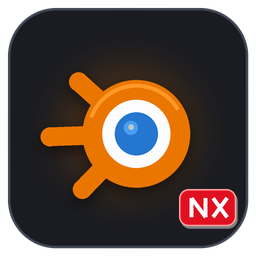
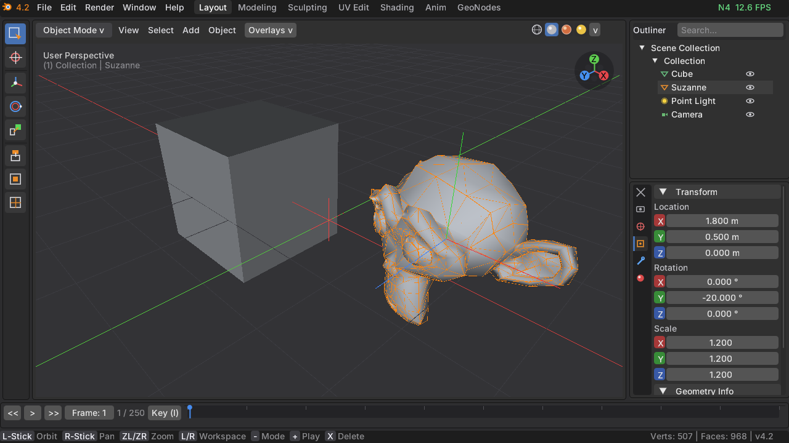
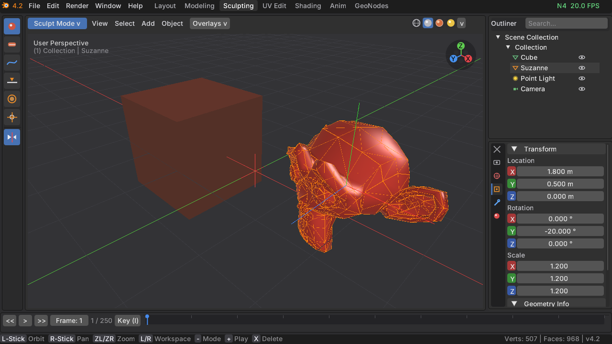
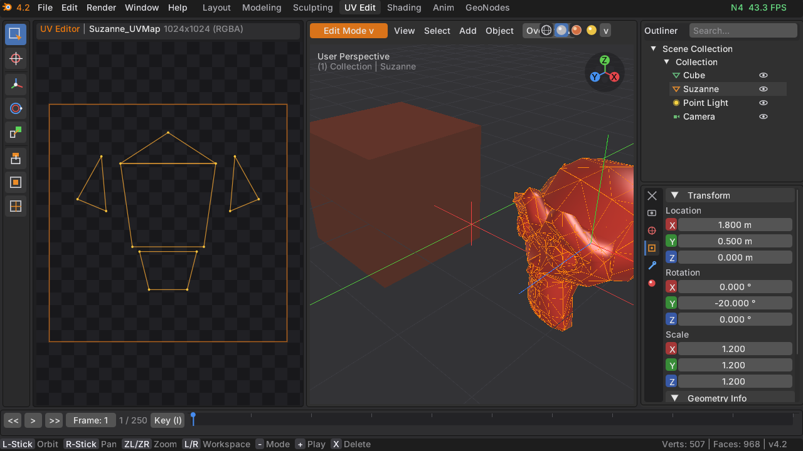
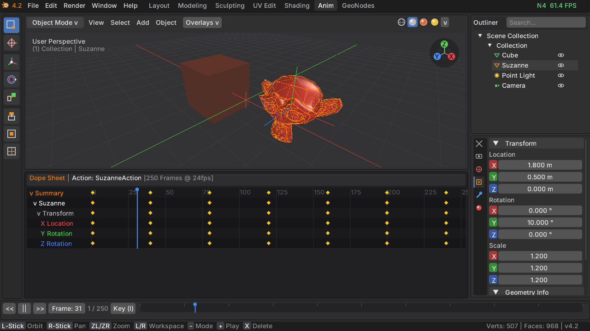
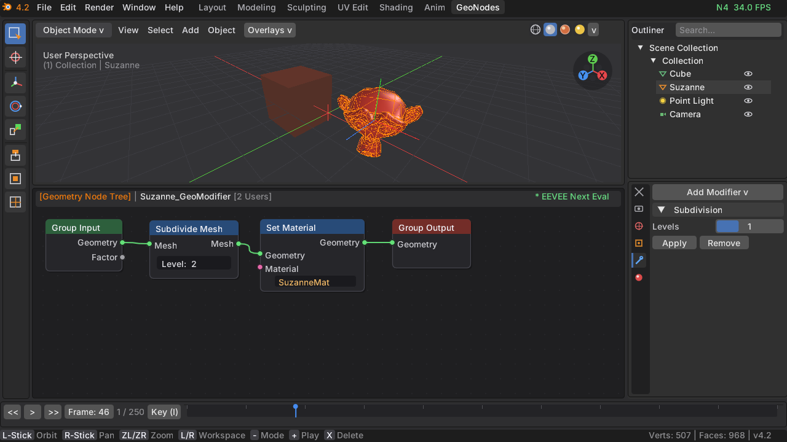

  

<h1 align="center">Blender-NX (4.2 LTS)</h1>

  <strong>Native Blender 4.2 LTS 3D Creation Suite for Nintendo Switch (Nexvyn OS N3-N4)</strong> 
  <em>Port by <a href="https://github.com/sonerx7">sonerx7</a></em>

---

## Showcase

| Layout Workspace (60 FPS) | Sculpting Studio (Red Wax MatCap) |
| :---: | :---: |
|  |  |

| UV Editing (1024x1024) | Animation & Dope Sheet |
| :---: | :---: |
|  |  |

| Geometry Nodes (Noodle Graph) |
| :---: |
|  |

---

## Key Features
- **Native 1280x720 Fullscreen Execution:** Built for Nexvyn OS N3-N4 (`minNative: 1.2`, `targetNative: 2.0`, 256MB N4 profile) running at 60 FPS.
- **OpenGL 4.3 / EEVEE Next Viewport:** Studio lighting, procedural **Red Wax MatCap** shader, Wireframe, Material Preview (**Principled BSDF v2**), and Rendered mode.
- **7 Complete Workspaces:** `Layout`, `Modeling`, `Sculpting`, `UV Edit`, `Shading`, `Anim` (Dope Sheet), and `GeoNodes`.
- **Interactive 3D Sculpting:** Draw, Clay, Smooth, Flatten, Inflate, and Grab brushes with X-Axis symmetry.
- **Modifiers & Geometry Nodes:** Subdivision Surface, Mirror, Solidify, and visual Geometry Node graphs.
- **Scene Export:** Save/Export to `.blend`, `.obj`, `.gltf`, and `.stl`.
- **Full Nintendo Switch Controls:**
  - **L-Stick / Drag:** Orbit 3D Viewport
  - **R-Stick / Right-Drag:** Pan Camera
  - **ZL / ZR / Wheel:** Zoom In / Out
  - **L / R:** Switch Workspaces
  - **D-Pad:** Top / Front / Side / Reset View
  - **`-` (Minus) / `Tab`:** Toggle Object / Edit / Sculpt Mode
  - **`+` (Plus) / `Space`:** Play / Pause Animation
  - **`X`:** Delete Selected Object

## Installation (Nexvyn OS)
1. Install directly from the **Nexvyn OS App Store** (`Media -> Blender-NX`), **or**
2. Download `blender-nx.nxvapp` from [Releases](https://github.com/sonerx7/Blender-NX/releases) and place it into `sdmc:/NexvynOS/Applications/`.

## License
GNU General Public License v3.0 (`GPL-3.0`).
